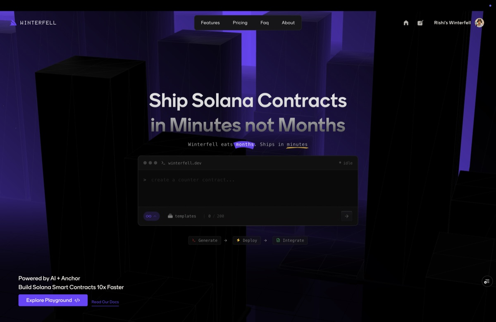
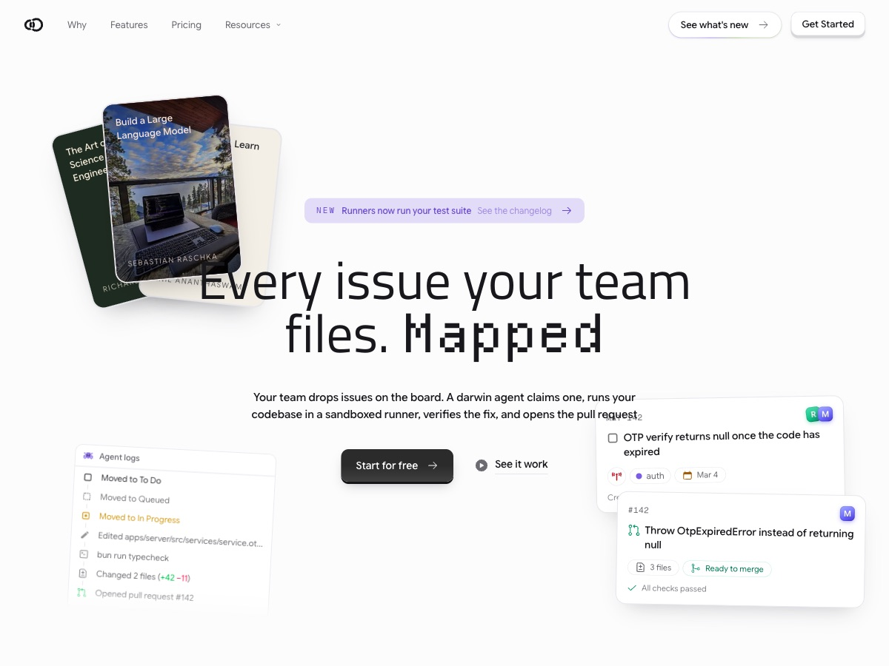
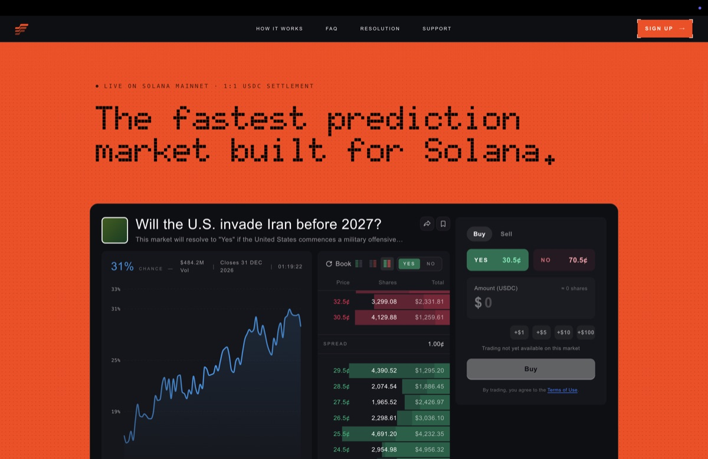
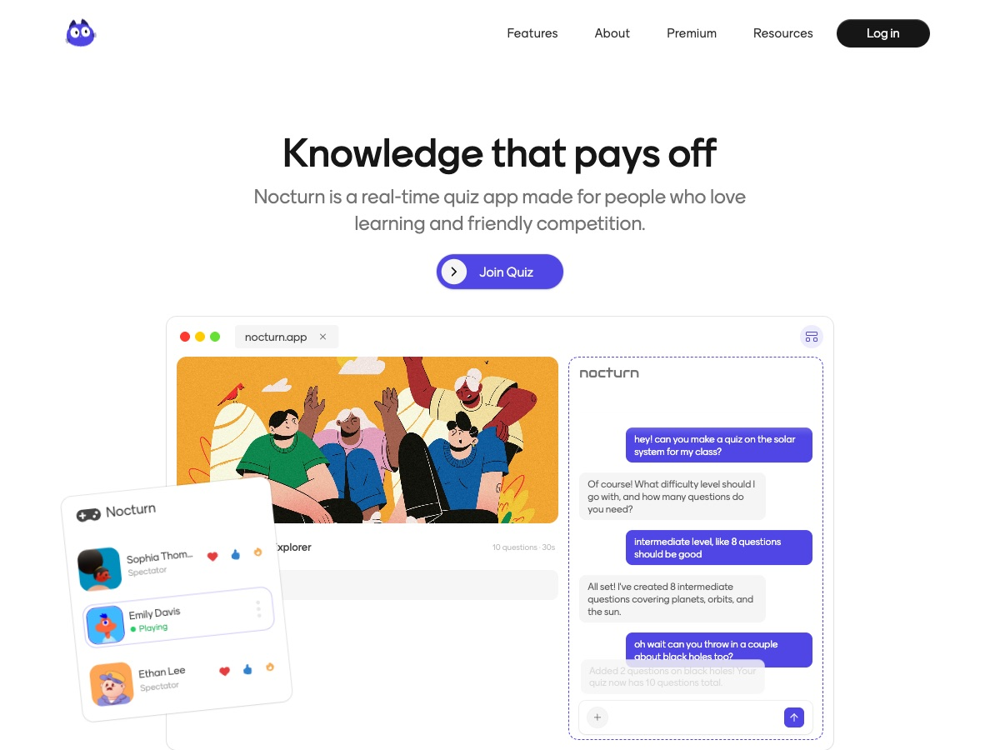
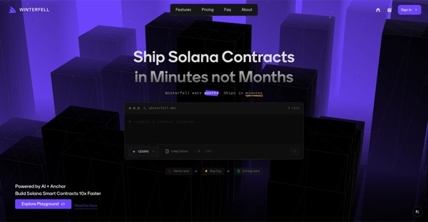
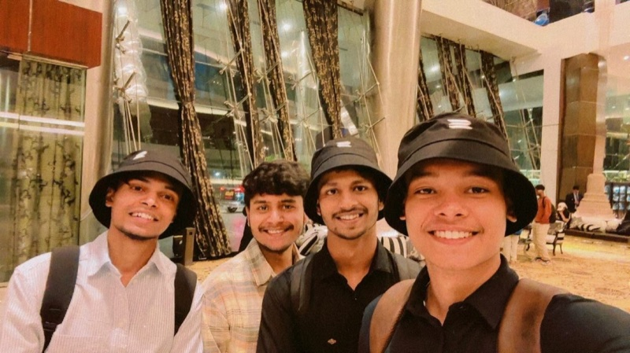
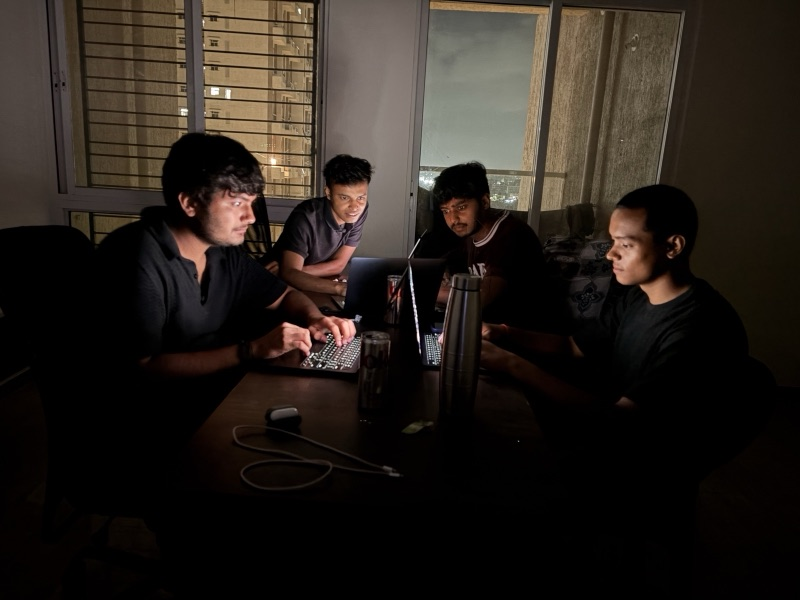
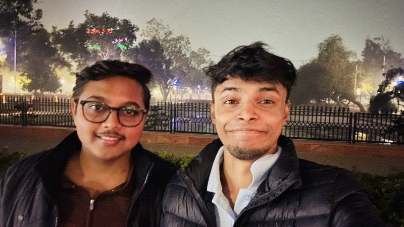

Engineer at <a href="https://appx.co.in">AppX</a> (YC S21) · Noida, India

I build applications end to end: the product, the backend behind it, and the infrastructure it runs on. Currently exploring infrastructure, the Ethereum chain, lending protocols, cryptography, and how MPC works under the hood.

Away from the terminal I am usually listening to something loud or reading about distributed systems.

 

### Work

<table>
  <tr>
    <td width="50%" valign="top">
      
        
      <b><a href="https://winterfell.dev">Winterfell</a></b> 
      Write, test and deploy Anchor smart contracts on Solana from the browser. First place at the Superteam India Hackathon.
    </td>
    <td width="50%" valign="top">
      
        
      <b><a href="https://heydarwin.app">Matcha</a></b> 
      An engineering board where an agent picks up an issue, works on it in its own sandbox, and opens the pull request for review.
    </td>
  </tr>
  <tr>
    <td width="50%" valign="top">
      
        
      <b><a href="https://highgarden.trade">HighGarden</a></b> 
      A prediction market built on Solana, made to settle fast.
    </td>
    <td width="50%" valign="top">
      
        
      <b><a href="https://nocturn.app">Nocturn</a></b> 
      A real-time quiz platform where players compete for on-chain rewards, with rooms synced over WebSockets and Redis Pub/Sub.
    </td>
  </tr>
</table>

 

### Experience

**Engineer at [AppX](https://appx.co.in)** (YC S21) &nbsp;·&nbsp; `NOV 2025 – NOW`
Building applications from the ground up for educators and creators, and the backend behind them, which serves 400 million requests a day with high availability.

**Open-source contributor at [Twenty](https://github.com/twentyhq/twenty)** &nbsp;·&nbsp; `2025`
Fixed UI bugs across the codebase, improving layout and responsiveness, and worked with the community to keep the design consistent across the platform.

 

### Case study

<table>
  <tr>
    <td width="200" valign="top">
      
    </td>
    <td valign="top">
      <b><a href="PORTFOLIO_URL/case-studies/taste-is-the-new-moat">Taste is the new moat</a></b> 
      How I built Winterfell end to end in 23 days, and why taste matters more now that AI can write the code. 264 commits, a $1,000 Superteam prize, and the parts I had to skip on stage.
    </td>
  </tr>
</table>

 

### Stack

`TypeScript` `Next.js` `React` `Tailwind CSS` `Node.js` `Socket.IO` `PostgreSQL` `Redis` `Kafka` `Docker` `Kubernetes` `AWS` `Solana` `Ethereum` `Solidity` `Hardhat`

 

### Personal

<table>
  <tr>
    <td></td>
    <td></td>
    <td></td>
    <td></td>
  </tr>
</table>

 

### Reach me

  
  &nbsp;&nbsp;
  <a href="https://github.com/kant-github" title="GitHub">
    <picture>
      <source media="(prefers-color-scheme: dark)" srcset="https://img.icons8.com/ios-glyphs/60/ffffff/github.png">
      
    </picture>
  </a>
  &nbsp;&nbsp;
  <a href="https://x.com/khairrishi" title="X">
    <picture>
      <source media="(prefers-color-scheme: dark)" srcset="https://img.icons8.com/ios-filled/50/ffffff/x.png">
      
    </picture>
  </a>
  &nbsp;&nbsp;
  
  &nbsp;&nbsp;
  

